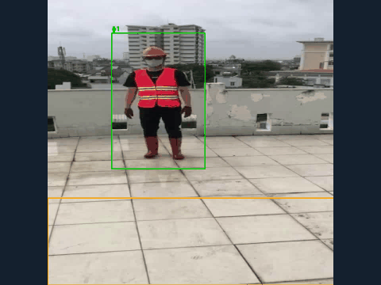
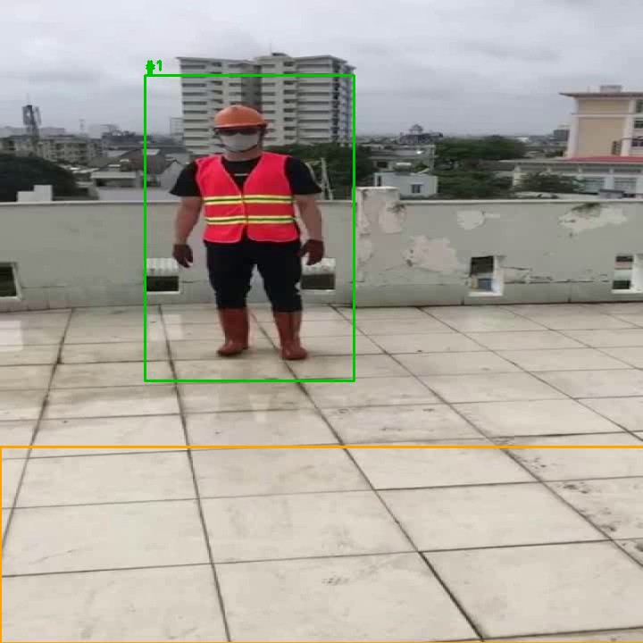
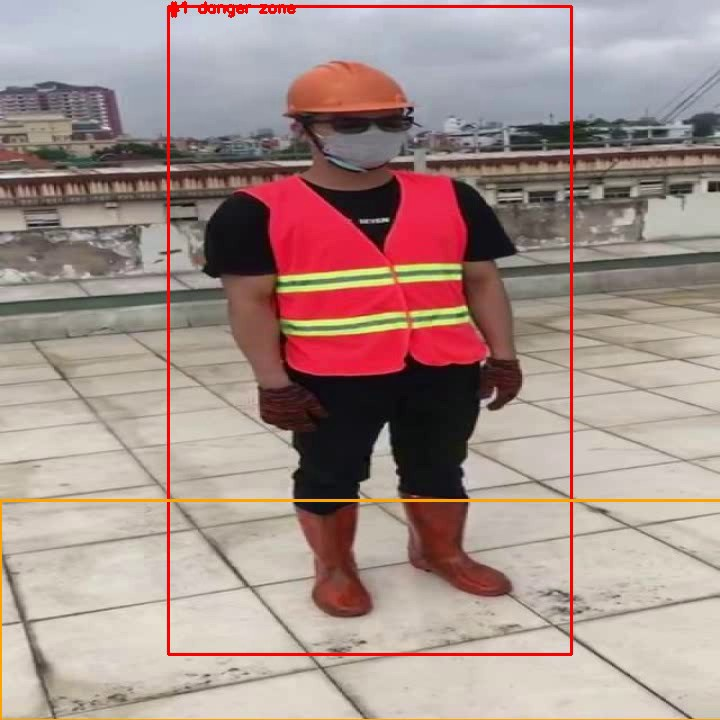
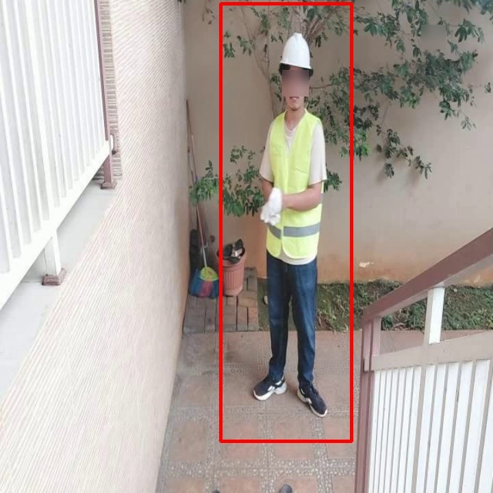
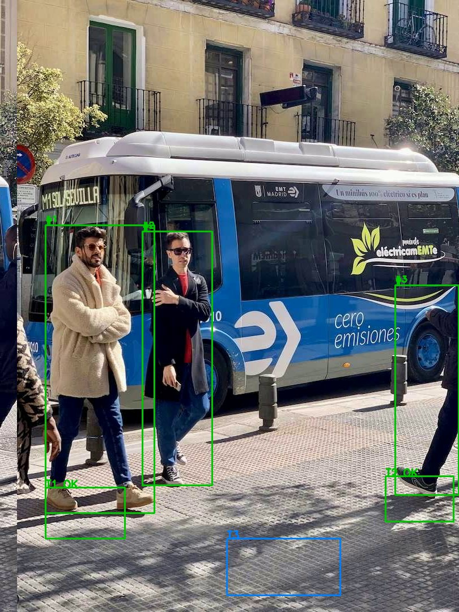

# Контроль СИЗ, опасных зон и ежедневного ТО по видео

Программа подключается к камерам, которые уже стоят на производстве или стройке, и в реальном времени проверяет три вещи:
- надеты ли у людей каска и сигнальный жилет;
- не зашёл ли кто-то в опасную зону;
- подходила ли бригада к каждому узлу оборудования из регламента ежедневного ТО.

О нарушении ответственный узнаёт по снимку в Telegram, лица на снимке размыты.

**Это витрина проекта.** Исходный код, инструкция по запуску и обученные веса лежат в [siz-vision-src](https://github.com/grozeser/siz-vision-src).



## Что умеет

- **Каски и жилеты.** Нейросеть находит людей, каски и сигнальные жилеты. Каска засчитывается, только если она на голове: каска в руке не считается.
- **Опасные зоны.** Зона задаётся многоугольником на кадре. Человек в зоне, если внутри точка его ног.
- **Ежедневное ТО.** На кадре размечаются узлы оборудования, например лебёдка, двигатель и тормоз. Пункт засчитывается, когда работник пробыл у узла нужное время. В конце смены выдаётся отчёт, что выполнено и что пропущено.
- **Без ложных тревог от одного кадра.** Люди отслеживаются между кадрами. Нарушение засчитывается, только если длится дольше порога, и уведомление одно на эпизод.
- **Приватность.** Лица на снимках размываются, распознавания личности нет.
- **Любой источник.** Подходит видеофайл, веб-камера или IP-камера по RTSP.

## Скриншоты

| | |
|---|---|
|  |  |
| Каска и жилет на месте: зелёная рамка | Работник зашёл в опасную зону (оранжевая граница): красная рамка |
|  |  |
| Снимок для Telegram: лицо размыто | Контроль ТО: узлы T1 и T2 выполнены, T3 пропущен |

Отчёт по ТО в конце смены:

```
ТО: выполнено 2 из 3
  + Лебёдка — на 2 с
  + Двигатель — на 2 с
  - Тормоз — НЕ выполнено
```

## Результаты

Детектор — YOLOv8s, дообученный на открытом датасете Construction-PPE: 1132 фото для обучения, 143 для проверки. Обучение шло на видеокарте GTX 1660 Ti.

| Класс | mAP50 | Recall |
|---|---|---|
| каска | 0,83 | 0,83 |
| сигнальный жилет | 0,82 | 0,83 |
| человек | 0,89 | 0,89 |

- На 11 из 12 незнакомых фото ложных тревог нет. Единственная ошибка — рабочий, срезанный краем кадра, у которого каски не видно.
- Опасная зона срабатывает ровно через заданные 2 секунды, по одному событию на человека.
- Скорость — 18 кадров в секунду на GTX 1660 Ti.

## Как сделано

- Python, Ultralytics YOLO, PyTorch с CUDA, OpenCV.
- Свой трекер людей по перекрытию рамок. Встроенный трекер терял только что появившуюся каску при смене сцены и выдавал ложное «без каски».
- Порог по времени и чек-лист ТО — отдельные модули без зависимостей. Их проверяют автотесты в GitHub Actions на каждый push.
- Размытие лиц, запись размеченного видео, отправка снимков в Telegram через Bot API.

## Что дальше

- Трекер с памятью, чтобы человек не терял номер, когда детектор пропустил его на один кадр.
- Нейросетевой детектор лиц для профиля и масок.
- Распознавание самого действия у узла ТО по позе рук, а не только присутствия.
- Веб-панель: разметка зон и узлов мышкой, журнал нарушений.

## Автор

[@grozeser](https://github.com/grozeser)
